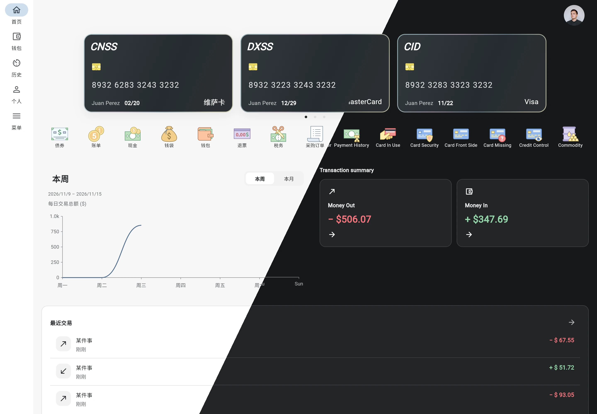
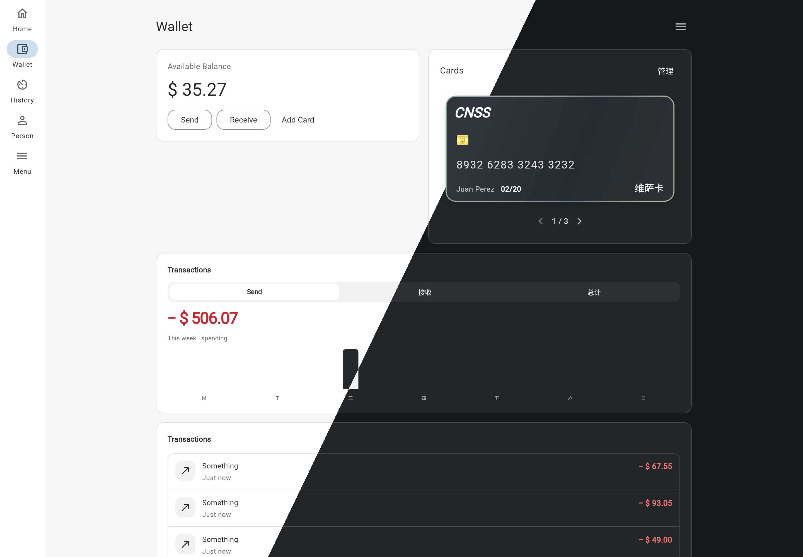
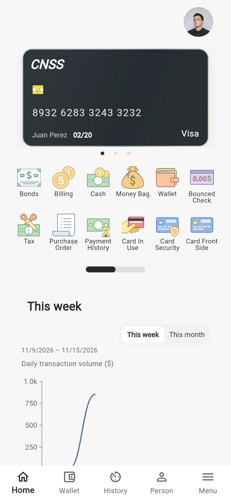
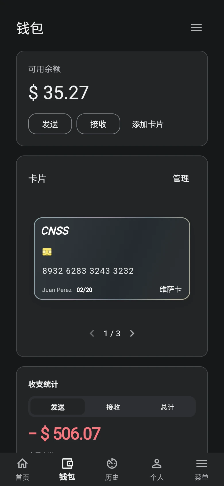
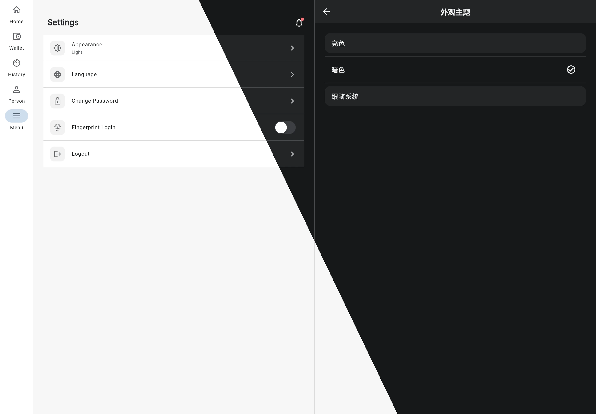

# SircApp

[简体中文（默认）](README.md) | English

[](https://github.com/jixiaoyong/SircApp/actions/workflows/main.yml)

## Introduction and online demo

SircApp is a responsive Flutter finance UI and local interaction demo, with adaptive phone and desktop layouts, light/dark themes, and Chinese/English localization. **This is not a real bank or a production financial service.**

[Try the online demo](https://jixiaoyong.github.io/SircApp/). The hosted demo follows the deployed `master` branch and may differ from the latest development version.

## Current UI: narrow and wide

These screenshots were captured from the locally running app on 2026-11-11, not from design mockups. The screens have been recaptured and saved as WebP. Two diagonal comparisons cover all four Chinese/English and light/dark combinations. Each pair uses the same page and viewport, overlaid at the same origin with complementary masks along a line from 2/3 width at the top to 1/3 width at the bottom, without shifting or rearranging content.

**Home: light Chinese on the left, dark English on the right.**



**Wallet: light English on the left, dark Chinese on the right.**



**Narrow screens: Home (light English) and Wallet (dark Chinese).**

<p>
  
  
</p>

**Wide screens: detail views appear side by side rather than opening a new page.**



## Main capabilities

- **Responsive navigation and layouts:** bottom navigation on narrow screens, a navigation rail on wide screens, and adaptive dashboard and Wallet sections.
- **Home dashboard:** multiple bank cards, localized shortcuts, transaction summaries, local example articles, and weekly/monthly transaction curves. The chart aggregates daily **absolute income + absolute expense**, not balance or net income; it uses a zero-based adaptive amount axis and sparse date labels, distinguishes future dates from zero amounts, and supports point inspection.
- **Wallet and card management:** shared card selection across Home and Wallet; local card creation, editing, and deletion; transaction search, income/expense filters, date filtering, and detail pages.
- **Visual system and preferences:** coordinated light/dark surfaces, subtle card edge lighting, Chinese/English UI, and saved appearance/language preferences.
- **Context-aware navigation:** transaction and article details can be opened from their source views. Authentication and financial shortcuts demonstrate local UI flows, not complete banking operations.

## Quick start

Use [FVM](https://fvm.app/) and the Flutter version pinned in [`.fvmrc`](.fvmrc) (currently **3.47.9**). Use that Flutter SDK's bundled Dart; do not rely on the old Flutter 3.24 / Dart 3.5 setup instructions.

```sh
git clone https://github.com/jixiaoyong/SircApp.git
cd SircApp
fvm install
fvm flutter pub get
fvm flutter run -d chrome
```

For a release web build:

```sh
fvm flutter build web --release
```

The repository includes Android, iOS, Web, and macOS platform projects. Their presence does not mean every native target has been validated for every change. Native builds require the corresponding platform toolchain; for iOS, use macOS with Xcode and the CocoaPods setup required by the plugins.

## Demo data and limitations

- Cards and transactions are **in-memory mock data**. Generated transaction amounts may differ between app sessions; refreshing or restarting does not guarantee that card edits or transaction data persist.
- Displayed balances are examples, not real account balances. The Home chart is derived from the loaded transactions, not a banking backend, and excludes records whose dates cannot be interpreted.
- Preferences such as theme and language are persisted separately. Demo authentication uses ordinary local preferences and is **not secure credential storage**. Do not enter real passwords, card numbers, CVVs, or other sensitive information.
- Some avatars, icons, and linked content depend on network resources. Financial shortcuts do not imply implemented transfers, payments, investments, or other real banking services.

## Development and testing

```sh
fvm flutter test
fvm flutter analyze
```

Tests cover state/controllers, localization, navigation, responsive layouts, card management, themes, and chart aggregation/interactions. Static analysis currently has existing warning/info diagnostics; it should not be described as warning-free.

After changing localization contracts or translations, regenerate the localization facade:

```sh
fvm dart run tool/build_lang.dart
```

After changing Riverpod-generated declarations, regenerate code as needed:

```sh
fvm dart run build_runner build --delete-conflicting-outputs
```

[Web CI](.github/workflows/main.yml) runs tests and a release web build for pushes and pull requests targeting `master` (and supports manual runs). GitHub Pages deployment runs only after a successful push build on `master`; a local commit or a push to `dev` does not deploy it.

## Architecture and guides

- [`lib/features/`](lib/features/): feature-oriented auth, Home, Wallet, and settings code; Riverpod manages state, with repository/model layers where needed.
- [`lib/core/`](lib/core/): shared localization, storage, networking, and theme infrastructure.
- [`lib/routes/`](lib/routes/): GoRouter configuration and source-aware detail navigation.
- [`lib/widgets/`](lib/widgets/): reusable visual and responsive components.
- [`test/`](test/): unit and widget tests.
- [Localization development guide](lib/l10n/README.md) and [localization architecture](doc/localization_architecture_guide.md).

## More UI and design credits

The app also includes transaction details, card editing/management, appearance and language settings, profile/menu views, and local authentication examples. Explore them in the running app; not every shortcut represents a complete product feature.

The initial interface was inspired by a [finance app design on Huaban](https://huaban.com/pins/4619822724). We thank the original creator for the inspiration. Subsequent iterations follow the [UI 2.0 design](design/ui-v2.0.html), refining the visual style and responsive layouts.
