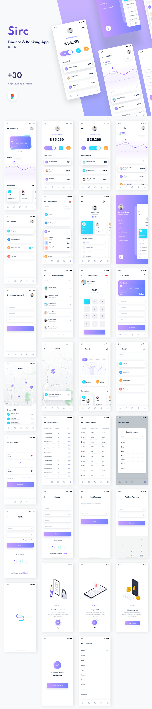

# SircApp 

A Finance Mobile Banking App.

You can try this app online at [https://jixiaoyong.github.io/SircApp](https://jixiaoyong.github.io/SircApp/).

## Environment

- **Flutter**: `3.24.0`
- **Dart**: `3.5.0`
- **FVM**: Supported (`fvm use 3.24.0`)

## Getting Started

To learn how to build this app by yourself, follow the steps below:

1. Clone the repository.
2. Install the flutter dependencies (`fvm flutter pub get` or `flutter pub get`).
3. Build the app.
4. Run the app.

For more information, please refer to the [official guideline](https://docs.flutter.dev/deployment/android#build-an-apk)

## App Sketch and Design

## Architecture & Guidelines

- **Localization / 国际化架构**: 采用基于 Dart 抽象类契约的分层多语言方案（支持业务命名空间与双语悬浮预览，详见 [多语言架构规范](doc/localization_architecture_guide.md)）。

