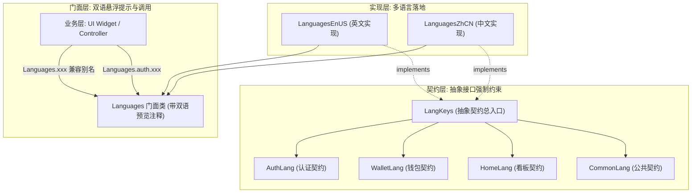

# 现代强类型分层多语言架构规范 (Type-Safe Layered Localization Architecture)

> 本文档详细阐述 SircApp 多语言/国际化（l10n/i18n）的设计理念、架构演进、分层命名空间规范以及实战开发 SOP。

---

## 目录
- [一、 背景与演进历程](#一-背景与演进历程)
- [二、 核心设计思想](#二-核心设计思想)
- [三、 整体架构蓝图](#三-整体架构蓝图)
- [四、 目录与文件组织规范](#四-目录与文件组织规范)
- [五、 分层命名空间（Namespaces）设计](#五-分层命名空间namespaces设计)
- [六、 实战开发指南与范例](#六-实战开发指南与范例)
  - [1. 基础词条调用](#1-基础词条调用)
  - [2. 局部别名优化代码清爽度](#2-局部别名优化代码清爽度)
  - [3. 带参数与单复数动态文本](#3-带参数与单复数动态文本)
  - [4. 富文本（TextSpan）结构化支持](#4-富文本textspan结构化支持)
- [七、 词条新增与维护 SOP](#七-词条新增与维护-sop)
- [八、 编译期门禁与自动化单测](#八-编译期门禁与自动化单测)

---

## 一、 背景与演进历程

在过往的多语言实践中，常见的实现模式存在诸多工程隐患：

1. **魔法字符串 `.tr` 模式（易错、难重构）**：
   - 依赖运行时字典查找，手写字符串极易产生大小写、拼写错误，编译期无法感知，容易在线上静默失效。
2. **长英文句子作为 Key（脆弱、割裂）**：
   - 以整段英文句子（如 `'Original password incorrect or update failed'`）作为 Map 的 Key，与代码里的驼峰变量严重脱节，且只要修改文案中的一个标点符号，所有映射直接失效。
3. **单文件膨胀与 Git 冲突**：
   - 所有词条集中在一个几千行的文件里，团队多人协作时频繁产生 Merge Conflict。
4. **参考借鉴与升华**：
   - 借鉴智蛙工程（`lang_library`）的**简短语义化 Key** 与 **IDE 双语悬浮预览注释**；
   - 结合现代 Dart 3 面向对象契约（`abstract class`），实现**零第三方依赖、编译期 100% 漏翻拦截、分层命名空间隔离**。

---

## 二、 核心设计思想

1. **契约驱动，编译期防漏（Interface-Driven）**：
   - 使用 Dart 的 `abstract class` 作为全局词条契约。所有具体的语言（中文 `LanguagesZhCN`、英文 `LanguagesEnUS`）必须 `implements` 该接口。
   - **核心收益**：契约中只要新增了一个词条，若中文或英文漏翻任何一项，**Dart 编译器直接报红线编译报错**，彻底杜绝线上“漏翻回退”问题。
2. **分层命名空间（Layered Namespaces）**：
   - 按业务域解耦（如 `Languages.auth.xxx`、`Languages.wallet.xxx`），避免全局数百个词条混在一起导致 IDE 提示爆炸与同名冲突。
3. **智蛙式双语注释悬浮预览（Bilingual Hover Tooltips）**：
   - 门面类上带有标准 DartDoc 注释（`///- [zh_CN] ... ///- [en_US] ...`），写代码时鼠标悬浮即可实时预览双语文本，无需在文件之间来回翻找。
4. **无 Context 约束 & $O(1)$ 寻址性能**：
   - 全局任何层级（UI Widget、Riverpod Controller、Domain Service、Utils）皆可直接调用；
   - 基于多态 Getter 属性访问，内存直接寻址，彻底省去字符串 Hash 计算与运行时 Map 查表开销。
5. **渐进兼容（Zero Migration Breaking）**：
   - 门面保留扁平别名代理，原有历史调用 `Languages.xxx` 零改动平滑运行，新业务随心使用分层命名空间。

---

## 三、 整体架构蓝图



---

## 四、 目录与文件组织规范

多语言模块归整在 `lib/data/l10n/` 目录下（保持高内聚），结构如下：

```text
lib/data/l10n/
├── README.md                  # 本设计规范就近文档
├── lang_keys.dart             # 契约总接口 LangKeys
├── keys/                      # 业务模块契约
│   ├── auth_keys.dart         # 登录/注册/密码契约
│   ├── wallet_keys.dart       # 钱包/银行卡/历史明细契约
│   ├── home_keys.dart         # 首页/金刚区/看板契约
│   ├── settings_keys.dart     # 设置/关于/通知契约
│   └── common_keys.dart       # 公共按钮/弹窗/缺省页契约
├── impl/                      # 语言具体实现
│   ├── zh/                    # 中文实现模块 (AuthZh, WalletZh...)
│   │   └── languages_zh.dart  # LanguagesZhCN 聚合入口
│   └── en/                    # 英文实现模块 (AuthEn, WalletEn...)
│       └── languages_en.dart  # LanguagesEnUS 聚合入口
├── languages.dart             # 全局静态统一门面 (自动生成或聚合)
└── app_locale.dart            # 全局 Locale 状态与切换控制
```

---

## 五、 分层命名空间（Namespaces）设计

| 命名空间 | 对应契约 | 覆盖业务范畴 | 典型词条示例 |
| :--- | :--- | :--- | :--- |
| **`Languages.auth`** | `AuthLang` | 登录、注册、找回密码、密码校验、验证码 | `signIn`, `oldPasswordIncorrect`, `passwordInconsistent` |
| **`Languages.wallet`** | `WalletLang` | 钱包看板、银行卡管理、CVV、交易流水明细 | `availableBalance`, `addCard`, `cardNumber`, `expireDate` |
| **`Languages.home`** | `HomeLang` | 首页顶部看板、月份选择、收支图表、金刚区分类 | `february`, `mon`, `quickActions`, `follow`, `hot` |
| **`Languages.settings`** | `SettingsLang` | 语言切换、通知中心、关于软件、退出登录 | `language`, `notifications`, `aboutUs`, `logout` |
| **`Languages.common`** | `CommonLang` | 通用确认/取消按钮、网络错误提示、加载中 | `confirm`, `cancel`, `loading`, `notFound`, `tryAgain` |

---

## 六、 实战开发指南与范例

### 1. 基础词条调用
```dart
// 层级式调用（推荐在新模块中采用）
Text(Languages.auth.signIn)
Text(Languages.wallet.cardNumber)

// 兼容别名调用（已有历史代码完全兼容）
Text(Languages.cancel)
```

### 2. 局部别名优化代码清爽度
在包含大量文案的表单或复杂页面中，使用静态别名让代码保持清爽：
```dart
class SignUpPage extends ConsumerWidget {
  const SignUpPage({super.key});

  // 局部别名：该页面专注于 auth 文案
  static final _l10n = Languages.auth;

  @override
  Widget build(BuildContext context, WidgetRef ref) {
    return Column(
      children: [
        Text(_l10n.signUp),
        TextFormField(
          decoration: InputDecoration(
            hintText: _l10n.pleaseInputNewPassword,
          ),
        ),
      ],
    );
  }
}
```

### 3. 带参数与单复数动态文本
直接在契约中定义强类型方法，参数受编译器严格保护：
```dart
// 1. 契约定义
abstract class WalletLang {
  String cardCount(int count);
}

// 2. 中文实现 (languages_zh.dart)
@override
String cardCount(int count) => '共 $count 张卡片';

// 3. 英文实现 (languages_en.dart) - 原生单复数分支
@override
String cardCount(int count) => count == 1 ? '1 card in total' : '$count cards in total';

// 4. 业务层调用
Text(Languages.wallet.cardCount(cards.length))
```

### 4. 富文本（TextSpan）结构化支持
长文本中间带点击链接（如“我已阅读并同意《服务条款》和《隐私政策》”），使用结构化元组彻底摆脱脆弱的正则匹配：
```dart
// 契约定义结构化元组
(String prefix, String terms, String andText, String privacy) get termsSpans;

// 业务层安全渲染
final (prefix, terms, andText, privacy) = Languages.auth.termsSpans;
RichText(
  text: TextSpan(
    children: [
      TextSpan(text: prefix),
      TextSpan(
        text: terms,
        style: const TextStyle(color: Colors.blue),
        recognizer: TapGestureRecognizer()..onTap = openTerms,
      ),
      TextSpan(text: andText),
      TextSpan(
        text: privacy,
        style: const TextStyle(color: Colors.blue),
        recognizer: TapGestureRecognizer()..onTap = openPrivacy,
      ),
    ],
  ),
);
```

---

## 七、 词条新增与维护 SOP

当开发新功能需要新增文案时，只需执行极其自然的**三步法**：

1. **第一步（契约声明）**：
   在对应业务模块的契约文件（如 `lib/data/l10n/keys/auth_keys.dart`）中声明 Getter 或方法：
   ```dart
   String get biometricLoginPrompt;
   ```
2. **第二步（补齐中英双语实现）**：
   此时 Dart 分析器会自动提示未实现报错，分别在 `zh` 与 `en` 实现类中补全：
   - 中文：`@override String get biometricLoginPrompt => '请使用指纹或面容完成验证';`
   - 英文：`@override String get biometricLoginPrompt => 'Please authenticate using biometric';`
3. **第三步（门面生成/暴露）**：
   在 `Languages.auth` 门面上增加带注释的属性（或运行脚本自动生成）：
   ```dart
   ///- [zh_CN] 请使用指纹或面容完成验证
   ///- [en_US] Please authenticate using biometric
   static String get biometricLoginPrompt => _current.auth.biometricLoginPrompt;
   ```
   *完成！全项目立即享受 IDE 悬浮双语提示与类型安全保护。*

---

## 八、 编译期门禁与自动化单测

为保证团队协作时不出现空翻译、多余空格等问题，在 `test/core/localization_test.dart` 中建立自动化回归门禁：

```dart
void main() {
  test('多语言完整性与非空静态断言', () {
    final zh = LanguagesZhCN();
    final en = LanguagesEnUS();

    // 抽样或遍历所有业务模块
    expect(zh.auth.signIn.trim(), isNotEmpty);
    expect(en.auth.signIn.trim(), isNotEmpty);
    expect(zh.common.cancel.trim(), isNotEmpty);
    expect(en.common.cancel.trim(), isNotEmpty);
  });
}
```
运行 `flutter test` 时自动执行，任何遗漏或空字符串均会被 CI 门禁直接拦截。

